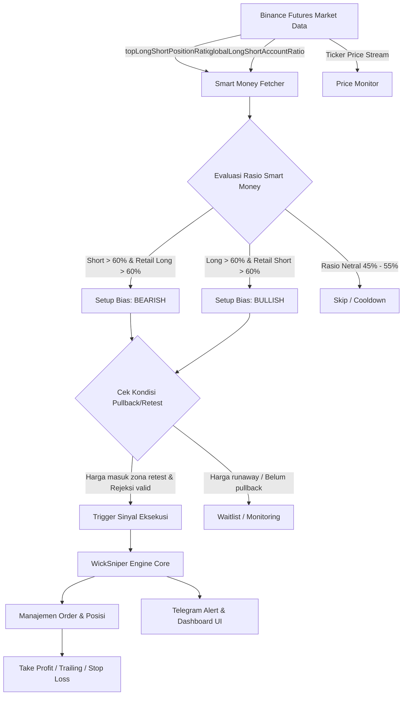

# 📐 Rencana Arsitektur & Implementasi: Smart Money Trigger (Zero-Bug)

Dokumen ini merinci rencana integrasi strategi **Smart Money Hunter** ke dalam bot `wicksniper_crypto`. Rencana ini dirancang dengan prinsip **Ponytail (Minimalist Senior Engineering)** dan **Zero-Bug Integrity**: memanfaatkan infrastruktur yang sudah matang tanpa membongkar logic trading kritis (eksekusi order, margin, trailing TP, SL, dan grid).

---

## 1. Analisis Akar Masalah WickSniper & Solusi Smart Money

| Masalah pada WickSniper (Lama) | Solusi dengan Smart Money Trigger (Baru) |
| :--- | :--- |
| **Melawan Trend Raksasa (Monster Pump/Dump):** Wick hunting rentan tersapu jika koin dipompa/dibuang oleh institusi tanpa retrace. | **Searah dengan Aliran Dana Paus (Institutional Flow):** Hanya membuka posisi yang searah dengan konsentrasi modal terbesar (>60% volume institusi). |
| **FOMO Entry:** Masuk terburu-buru saat lilin spike masih berjalan. | **Pullback / Retest Zone Entry:** Menunggu harga memantul ke area likuiditas retail yang tersangkut (trapped retail) sebelum eksekusi. |
| **Sinyal Palsu Retail:** Tertipu oleh lonjakan volume retail kecil. | **Divergensi Smart Money vs Retail:** Memvalidasi bahwa akun retail terjebak di arah yang salah. |

---

## 2. Arsitektur Alur Sinyal & Eksekusi



---

## 3. Desain Toggle & Mode Strategi (Non-Breaking)

Agar strategi lama tetap bisa digunakan sewaktu-waktu dan tidak merusak konfigurasi pengguna yang sudah ada, kita menambahkan parameter baru ke `BotConfig` secara modular:

### Pilihan Mode Strategi (`triggerStrategy`):
1. **`SMART_MONEY` (Rekomendasi Baru):** Bot mencari koin yang memiliki dominasi modal institusional sepihak dan menunggu titik entry pullback/retest.
2. **`WICK_SNIPER` (Strategi Lama):** Bot tetap berburu lonjakan kilat sumbu lilin (original).
3. **`HYBRID` (Filter Konfirmasi):** Bot hanya mengeksekusi lonjakan WickSniper jika searah dengan bias Smart Money (misal: hanya tembak Short spike jika Smart Money sedang memegang posisi net Short).

### Struktur Konfigurasi (`src/types.ts`):
```typescript
export interface SmartMoneyConfig {
  enabled: boolean;
  mode: 'STANDALONE' | 'FILTER_ONLY'; // STANDALONE = Entry mandiri, FILTER_ONLY = Filter arah WickSniper
  direction: 'BOTH' | 'SHORT_ONLY' | 'LONG_ONLY';
  period: '5m' | '15m' | '1h'; // Interval analisis rasio Binance
  thresholdRatio: number; // Ambang batas dominasi posisi (default: 0.60 atau 60%)
  retailTrapFilter: boolean; // Wajib konfirmasi retail berada di sisi berlawanan
  pullbackMinPct: number; // Menunggu koreksi harga X% ke arah retest sebelum entry (default: 0.8%)
  cooldownMinutes: number; // Jeda antar sinyal koin yang sama (default: 30 menit)
  maxSymbolsToScan: number; // Batas koin aktif untuk hemat kuota REST API (default: 20 koin teratas)
}
```

---

## 4. Rincian Metrik Data Binance Resmi yang Digunakan

| Endpoint Resmi FAPI | Metrik yang Diukur | Bobot / Safety |
| :--- | :--- | :--- |
| `GET /futures/data/topLongShortPositionRatio` | **Rasio Nilai Nosional Modal Top Trader** (Persis data 33% vs 67% di screenshot Anda) | Bobot 1 (Sangat aman, tanpa limit IP) |
| `GET /futures/data/topLongShortAccountRatio` | **Rasio Jumlah Akun Top Trader** (Melihat berapa trader besar yang pasang posisi) | Bobot 1 |
| `GET /futures/data/globalLongShortAccountRatio` | **Sentimen Seluruh Trader Retail** (Untuk mendeteksi retail yang terjebak/trapped) | Bobot 1 |

> [!NOTE]
> Semua pemanggilan REST API ini otomatis melewati modul **Cloudflare DoH (DNS-over-HTTPS)** yang sudah terpasang di `src/services/binance.ts`, sehingga kebal terhadap pemblokiran ISP / TrustPositif di Indonesia.

---

## 5. Rencana Eksekusi Bertahap (Zero-Bug Roadmap)

### **Tahap 1: Service Data Fetcher Smart Money**
* Buat method `getSmartMoneyMetrics(symbol, period)` di [`src/services/binance.ts`](file:///c:/Office/zaky/project%20trading%20ai/wicksniper_crypto/src/services/binance.ts).
* Terapkan *in-memory cache* (TTL 60 detik) untuk setiap simbol agar tidak ada spam request ke Binance dan kuota API tetap berada di bawah 5%.

### **Tahap 2: Smart Money Trigger Scanner**
* Buat kelas `SmartMoneyScanner` (atau integrasikan ke scanner yang ada) yang secara berkala memeriksa daftar koin aktif.
* Menganalisis kondisi:
  * **Sinyal SHORT:** `topLongShortPositionRatio < 0.65` (Whale dominan Short) AND `globalLongShortAccountRatio > 1.2` (Retail dominan Long).
  * **Sinyal LONG:** `topLongShortPositionRatio > 1.50` (Whale dominan Long) AND `globalLongShortAccountRatio < 0.8` (Retail dominan Short).
* Menghitung area konfirmasi Pullback/Retest sebelum memancarkan event `onSignal`.

### **Tahap 3: Integrasi Engine & Eksekusi**
* Hubungkan event sinyal ke [`WickSniperEngine.handleSignal()`](file:///c:/Office/zaky/project%20trading%20ai/wicksniper_crypto/src/services/engine.ts).
* Mendukung pembukaan posisi **SHORT** maupun **LONG** dengan modul manajemen risiko yang sudah teruji:
  * Pengaturan Leverage & Margin
  * Target Take Profit (TP & Trailing TP)
  * Hard Stop Loss & Trailing SL
  * Break-Even Protection (BEP)

### **Tahap 4: Antarmuka UI & Kontrol Pengguna**
* Tambahkan **Toggle Strategi** di Modal Pengaturan [`public/index.html`](file:///c:/Office/zaky/project%20trading%20ai/wicksniper_crypto/public/index.html):
  * Dropdown: `Pilihan Strategi Pemicu: [Smart Money Hunter | Wick Sniper | Hybrid]`
  * Form input: Ambang Rasio Smart Money, Filter Retail Trap, dan Pullback Target.
* Tambahkan kartu metrik Smart Money di Dashboard agar pengguna bisa langsung melihat rasio koin yang sedang dipantau atau dibuka posisinya.

---

## 6. Protokol Pengujian & Validasi

1. **Unit Test API Fetcher:** Menjalankan script validasi mandiri untuk memverifikasi akurasi data rasio Binance vs data dashboard web Binance.
2. **Paper Trading Verification:** Menjalankan bot dalam mode `PAPER` terlebih dahulu untuk memantau perilaku trigger, kalkulasi pullback, dan eksekusi posisi virtual tanpa risiko modal nyata.
3. **Safety Fallback Check:** Menguji skenario saat API Binance lambat/gagal agar bot tidak hang atau menembakkan order ganda (double-spend protection).
